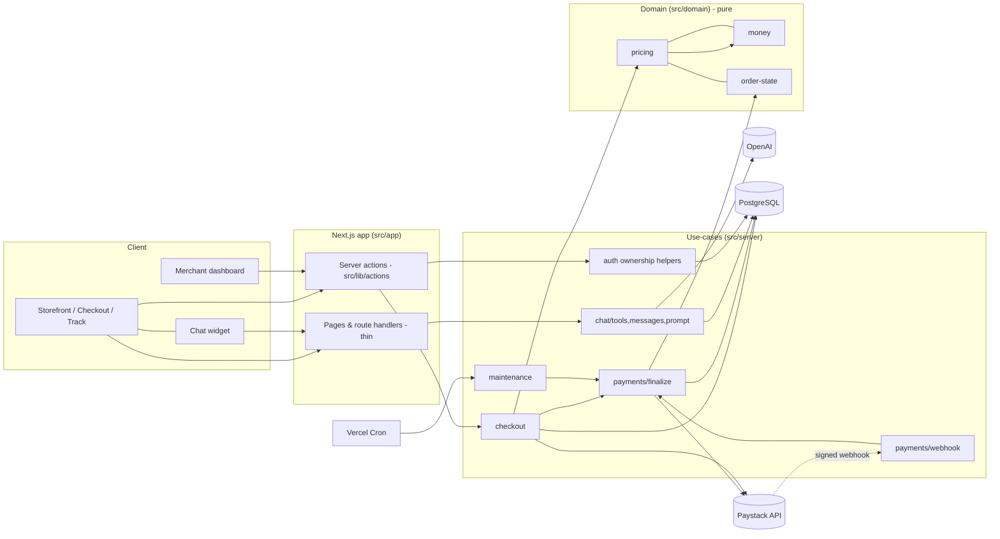
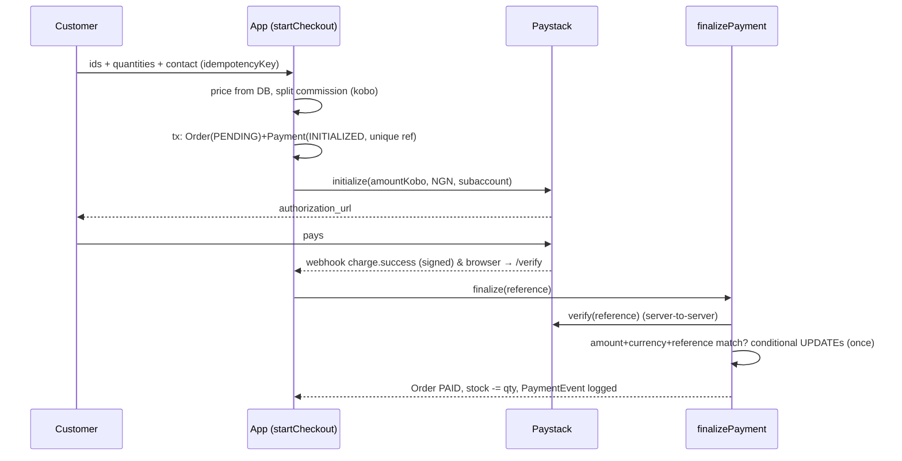

# LinkStore – Architecture

_Status: reflects the code in this repository after the hardening pass. Items marked **Not implemented** are real gaps, not plans in disguise._

## 1. Current (original) vs target architecture

**Original** – a Next.js monolith where server actions did everything: they read client-supplied totals, trusted a client-supplied role, and several only checked "signed in". Payment success was inferred from a browser redirect. No webhook existed. The chatbot used `ai@3.4` with an `@ai-sdk/openai@3` provider (mismatched specs) and fed client messages straight to the model.

**Target (implemented)** – still a *modular monolith* (no microservices/queues were justified):

## 2. Modules and dependency direction
| Module | Responsibility | May depend on |
|---|---|---|
| `src/domain/*` | money (kobo, commission), trusted pricing, order state machine | nothing |
| `src/server/checkout.ts` | validate → price → persist Order+Payment → initialise Paystack | domain, lib |
| `src/server/payments/finalize.ts` | the single path to PAID (verify, compare, idempotent apply, stock) | domain, lib |
| `src/server/payments/webhook.ts` | signature check, event log (idempotency), dispatch | finalize |
| `src/server/maintenance.ts` | reconcile missed webhooks, expire attempts, cancel orders, prune chats | finalize |
| `src/server/auth.ts` | ownership helpers (store/product/order) | lib |
| `src/server/chat/*` | message sanitising, system prompt, read-only tools | domain, lib |
| `src/lib/actions/*` | thin server actions: authorise → validate → call use-case | server, domain |
| `src/lib/*` | adapters: prisma, paystack, env, logger, rate-limit | – |
Direction: `app → actions → server → domain`; adapters in `lib` are leaves.

## 3. Data model (PostgreSQL / Prisma)
Existing: `Store`, `Product`, `ProductMedia`, `Variant`, `Order`, `OrderItem`, `Review`. Added (additive migration `20261016000000_payments_chat_integrity`):
- `Payment` – one row per attempt; **integer kobo** (`amountKobo`, `commissionKobo`, `merchantShareKobo`, `commissionBps` snapshot); unique `reference`; CHECKs: `amountKobo > 0` and `commission + merchantShare = amount`.
- `PaymentEvent` – append-only log; unique `eventKey` gives webhook idempotency; also holds `payment.amount_mismatch` and `stock.conflict` audit rows.
- `ChatConversation` / `ChatMessage` – storefront chat persistence (30-day retention).
- `Order.currency`, `Order.idempotencyKey` (unique), indexes on hot paths, `Review(orderId, productId)` unique.
**Money representation decision:** existing `Decimal` columns are exact, so they were *kept* (no destructive migration). All arithmetic converts to integer kobo first; new financial tables store kobo directly. Max order ₦10,000,000 (fits `INTEGER`).
**Migrations:** `0_init` is a baseline of the previous `db push` schema (existing DBs: `prisma migrate resolve --applied 0_init`). The second migration backfills a `Payment` row for historical paid orders at the old hard-coded 5%. Verified with `scripts/verify-migrations.mjs` (apply + backfill + drift check).

## 4. Payment lifecycle

- Payment status (`INITIALIZED|SUCCESS|FAILED|ABANDONED|REFUNDED`) is separate from fulfilment status (`PENDING→PAID→SHIPPED→DELIVERED`, plus `CANCELLED|REFUNDED`).
- Underpayment / wrong currency ⇒ payment marked `FAILED (AMOUNT_OR_CURRENCY_MISMATCH)`, order stays `PENDING`, error logged.
- Provider timeout at initialise ⇒ attempt left `INITIALIZED`; maintenance reconciles via verify. Definite refusal ⇒ attempt `FAILED`.
- Retry of the same checkout (same idempotency key) reuses the order, supersedes the old attempt, re-prices from current catalogue.
- Expiry: attempts unpaid after 24 h ⇒ `ABANDONED`, their `PENDING` orders ⇒ `CANCELLED`; a late successful payment revives a cancelled order.
- Webhook events handled: `charge.success`, `refund.processed` (payment+order ⇒ REFUNDED), `charge.dispute.create` (order flagged). Others logged and ignored.

### Commissions & settlement (what is and isn't guaranteed)
- Commission = store `commissionPercentage` (default 5%) in basis points, rounded half-up to the kobo; merchant share is the exact remainder. Snapshotted on each `Payment`.
- The split is **provider-managed**: the store's Paystack **subaccount** is passed on initialise and was created with `percentage_charge` = the commission %. The app *records* the expected split; it does **not** independently confirm settlement. Paystack fees are borne per the account's default bearer settings (not changed here).
- **Refunds (implemented):** a merchant *requests* a refund on a paid order (`Refund` row, `REQUESTED`); a **platform admin** (Clerk ids in `ADMIN_USER_IDS`) *approves*, which calls Paystack `POST /refund` with the exact kobo amount (official docs: amount optional, may not exceed the original). Status flows `REQUESTED → APPROVED → PROCESSING → PROCESSED | FAILED` (or `REJECTED`); the `refund.processed` / `refund.failed` webhooks complete it. Partial refunds are supported (sum of refunds ≤ payment amount, serialised with a row lock); only a *fully* refunded payment moves the Payment and Order to `REFUNDED`. Two admins cannot both approve (conditional update ⇒ provider called once). A provider **timeout** leaves the refund `APPROVED` with a "verify on Paystack before retrying" warning instead of risking a double refund. Why admin approval: with split payments the platform's commission and balance rules are involved, and Paystack's behaviour for who funds a refund on a subaccount transaction is not something this app can verify – so merchants cannot move money out unilaterally.
- **Reconciliation (implemented):** `reconcileLedger()` (internal, fully tested) flags paid orders without a successful payment, successful payments whose order isn't paid, order-total ≠ payment-amount, multiple successful payments for one order, attempts stuck >1 h, unresolved amount-mismatch and stock-conflict events, and refunds stuck >72 h. `compareSettlements()` compares each store's expected share (merchant share of successful payments, net of processed refunds) with Paystack's `/settlement` totals for its subaccount. **That provider call is informational and its response field names are NOT verified against a live account**; it degrades to `UNAVAILABLE` rather than guessing.
- **Admin visibility (implemented):** `/dashboard/admin/payments` (admins only; everyone else gets a 404) shows the ledger check, refund queue with approve/reject, settlement comparison and a filterable payments table.
- **Still not done:** automated alerting (findings are visible in the admin page and logs, not pushed to email/Slack), settlement *payout* reconciliation against bank statements, chargeback evidence workflow.
- Stores without a subaccount cannot take payments (default); override with `ALLOW_CHECKOUT_WITHOUT_PAYOUT=true` only if you intend to hold and pay out funds manually.

## 5. Security model
- Authn: Clerk; middleware protects only `/dashboard*` and `/setup*`; everything else is public by design.
- Authz: ownership checks in `src/server/auth.ts` for every merchant read/write; denial is indistinguishable from not-found. Customers act through the unguessable order id (capability); delivery-confirm role is derived on the server.
- Input: zod at every boundary; quantities, lengths, https-only URLs, slug reserved-word list.
- Webhooks: HMAC-SHA512 over the raw body, constant-time compare, event-key idempotency, re-verification with Paystack.
- Abuse: **global, database-backed** fixed-window limits (`RateLimitBucket`, one atomic UPSERT per check, shared by every instance; expired buckets purged by the maintenance job) on checkout, disputes, reviews, chat, merchant chat, order lookup, payout setup and public counters. If the database is unreachable the limiter fails open to a per-instance in-memory window and logs a warning. Cost: one extra DB round-trip per limited request.
- Logging: structured JSON, sensitive keys redacted, request ids on chat.
- Public leakage: product/store queries select only public fields; track/success pages remain capability URLs (anyone holding the order id sees that order incl. contact details – accepted trade-off, documented).

## 6. Chatbot architecture
Two assistants, both on AI SDK v6 / OpenAI, both **read-only by construction**:

**Shopper assistant** (public storefront): `widget → POST /api/chat → sanitizeConversation → load public store → streamText(tools) → UI stream`.
- History: last 12 text-only user/assistant messages ≤1000 chars; client `system`/tool parts dropped.
- Tools (store-scoped, allowlisted): `search_products` (in-stock only, per-option availability, **returns ids/images so the widget renders product cards**), `get_store_info`, `get_order_status` (order id + exact email/phone, rate-limited, generic failure, minimal fields), `checkout_link` (URL only).
- **Cart / checkout:** the assistant cannot place orders or take payment. Product cards in answers have a real *Add to cart* button that writes to the shopper's actual cart (explicit user action); *Go to checkout* opens the normal checkout, where prices are recomputed server-side and payment is verified with Paystack. This is the confirmation step for a consequential action.
- Controls: 20 msgs/10 min/IP (global limiter), 4 tool steps, 500 output tokens, 25 s timeout + client abort, generic errors, token usage logged, plain-text rendering, 30-day retention.

**Merchant assistant** (dashboard, `POST /api/merchant-chat`, Clerk-authenticated): store comes from the verified session via `requireStore()`; tools `sales_summary`, `list_orders` (first name only – no email/phone/address sent to the model), `find_products`, `low_stock`, and `propose_mark_shipped`, which **only returns a proposal**. The widget shows a *Confirm* button that calls the normal authorised server action (`updateOrderStatus`) – the model never executes a mutation. 40 msgs/10 min/merchant; conversations are **not persisted**.

Not implemented: embeddings/vector search (SQL search suffices), live-model evaluation of groundedness/injection resistance/latency/cost (see Testing), merchant-assistant write actions beyond mark-shipped.

## 7. Deployment
Vercel (Next.js) + managed Postgres; set `ADMIN_USER_IDS` (comma-separated Clerk user ids) to enable the admin payments page and refund approvals; `vercel.json` schedules `/api/cron/maintenance` every 15 min (**Vercel Hobby limits cron frequency – use Pro or an external scheduler**; set `CRON_SECRET`). Release step: `npm run db:deploy`. Configure the Paystack dashboard webhook URL to `https://<app>/api/webhooks/paystack`. `GET /api/health` reports DB/env readiness (names only).

## 8. Decisions & trade-offs
| Decision | Why | Trade-off |
|---|---|---|
| Keep modular monolith | Team size, traffic; no queue needed since webhooks are idempotent and a cron reconciles | Cron granularity bounds reconcile latency |
| Keep `Decimal` columns, compute in kobo | Avoids a destructive type migration; still precision-safe | Two representations at the boundary (`toKobo/fromKobo`) |
| Decrement stock on payment, not on order | No stock lock-up by abandoned carts | Possible oversell race → recorded as `stock.conflict` event; merchant must resolve |
| Upgrade to `ai@6` | Provider/SDK spec mismatch made the old chat route unreliable | Client/route rewritten; not exercised against live OpenAI here |
| In-memory rate limiting | No new infra | Not global across instances |
| Light-only theme | Product requirement | – |

## 9. Testing
79 automated tests (run with `npm run test:db`): pure unit tests (money, pricing, state machine, signature, sanitiser, redaction) and **integration tests on a real Postgres** built from the SQL migrations: checkout pricing/idempotency, finalize (underpay, currency, outage, 10-way concurrency, late payment, stock conflict), webhook (forgery, duplicates, outage retry, refund events), **refund workflow** (request→approve→webhook, partial refunds, concurrent approvals call the provider once, ambiguous timeout, rejection), **ledger reconciliation** (each finding type) and settlement comparison (provider mocked), cross-merchant authorization, shopper- and **merchant**-assistant tenant isolation / PII minimisation / propose-don't-act, the global rate limiter under concurrency (and proof the DB path is used), maintenance. Mutation checks confirmed the amount-check and idempotency tests fail when those guards are removed.
**Not covered:** browser E2E (no Playwright run), live-model behaviour (groundedness, model-level prompt-injection resistance, latency/cost), real Paystack sandbox calls, visual regression of the redesigned pages (not viewed in a browser while building).

## 10. Operations
`/api/health`; structured logs with events such as `payment.finalized`, `payment.amount_mismatch`, `payment.stock_conflict`, `webhook.bad_signature`, `checkout.initialize_failed`, `chat.completed`, `maintenance.done`. To answer "was this paid?": look up `Payment` by reference + its `PaymentEvent` rows.
